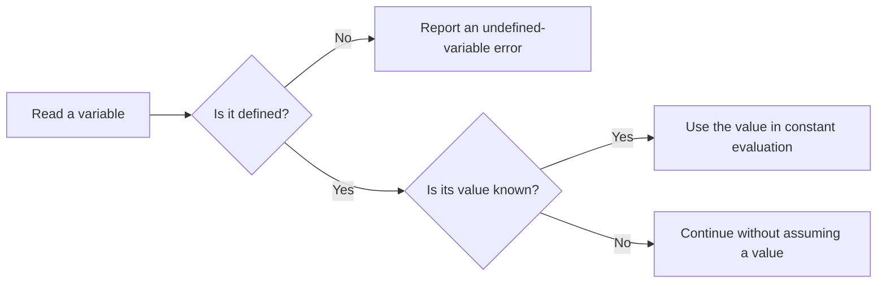
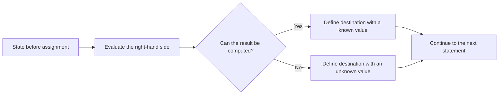
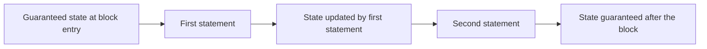
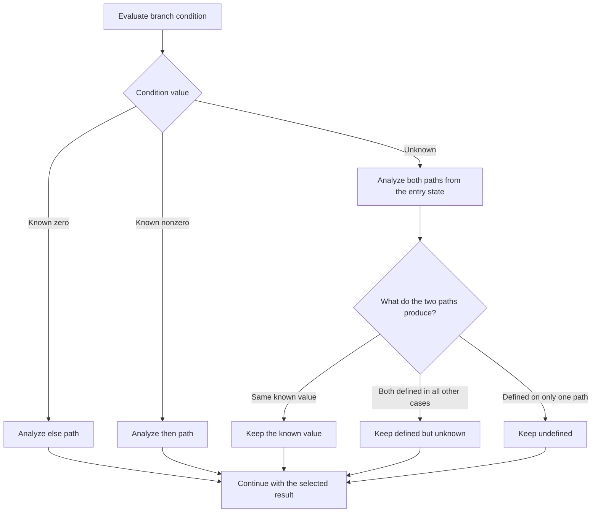
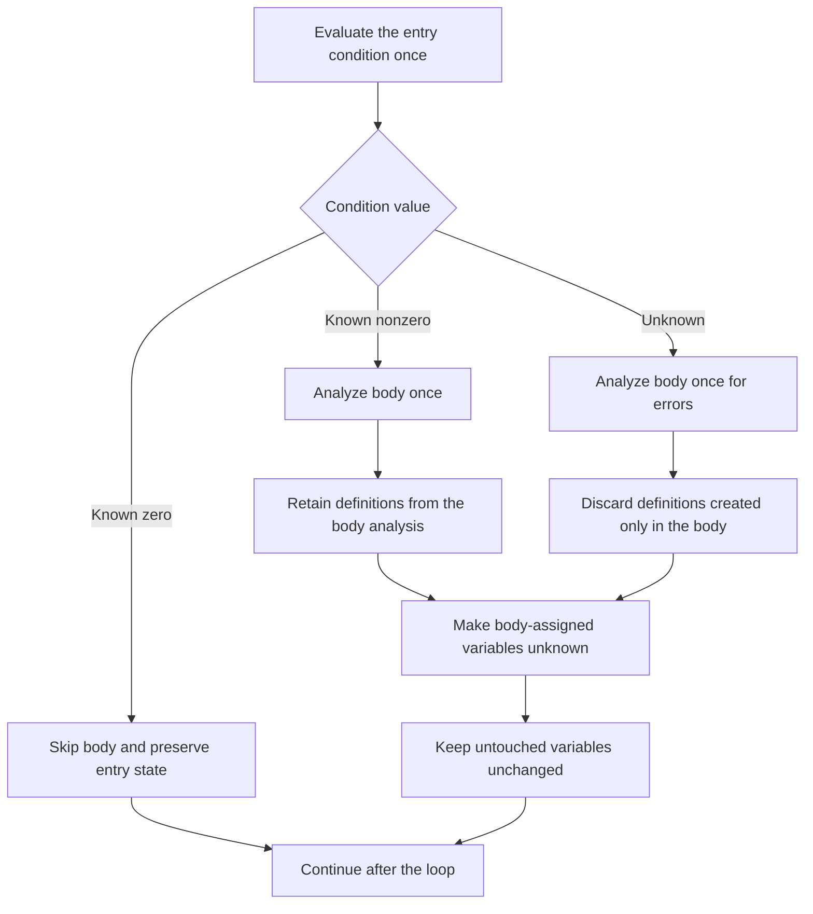

# Undefined Variable Analyzer

Undefined-variable analysis checks that every variable read is guaranteed to have a preceding assignment. It is a standalone validation phase: a valid program continues unchanged, while analysis stops at the first invalid read and reports the offending variable. The analysis neither executes nor rewrites the program.

## Analysis State

Each variable is in one of three states:

- **Undefined:** no assignment is guaranteed on the current path. Reading the variable is an error.
- **Defined with a known value:** a constant value can be used to evaluate later expressions and conditions.
- **Defined with an unknown value:** reading is allowed, but no particular value can be assumed.

Expressions are evaluated from left to right. Constants have known values. Arithmetic and comparisons produce known values only when all their operands are known; otherwise, their results are unknown.

An assignment evaluates its right-hand side before changing the destination. The destination then becomes defined, with either the computed known value or an unknown value. Output expressions are checked without changing the analysis state.

## Sequential Blocks

Statements are analyzed in execution order. A nested block inherits everything guaranteed at its entry and may also use assignments made earlier within that block. An assignment later in a block cannot justify an earlier read.

## Conditional Branches

The condition determines how the two paths are analyzed:

- A **known zero** selects only the else path.
- A **known nonzero value** selects only the then path.
- An **unknown value** requires analyzing both paths independently from the same entry state.

After an unknown-condition branch, a variable is defined only if both paths define it. Its value remains known only when both paths produce the same constant; otherwise, it becomes unknown.

## Loops

Only the loop condition's entry value is considered. The body is not repeatedly analyzed, and the analysis does not infer a trip count.

- **Known zero:** skip the body and preserve the entry state.
- **Known nonzero:** analyze the body once and retain definitions guaranteed by that analysis.
- **Unknown:** analyze the body once to find invalid reads, but do not export definitions created only inside the body.

After any analyzed body, every defined variable assigned anywhere in that body becomes unknown. Variables untouched by the body retain their previous values. This prevents the analysis from assuming that the loop executes exactly once.

## Diagnostics

Analysis stops at the first undefined read in evaluation order. It reports the variable name without source locations and does not collect additional diagnostics after that failure.
